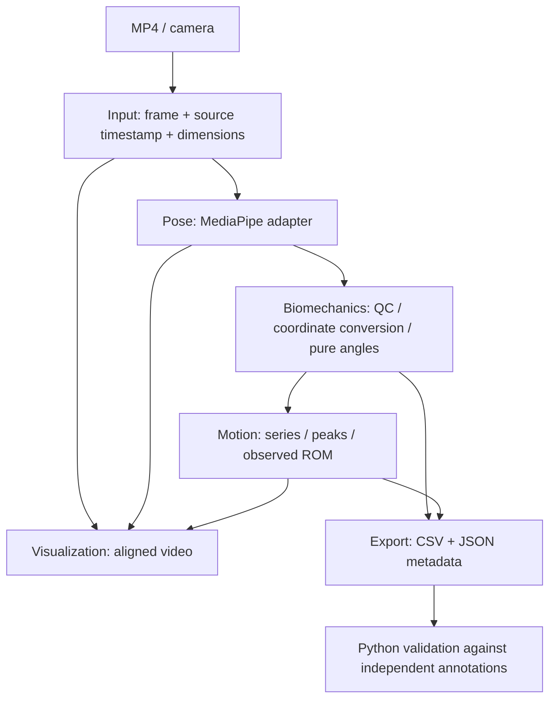
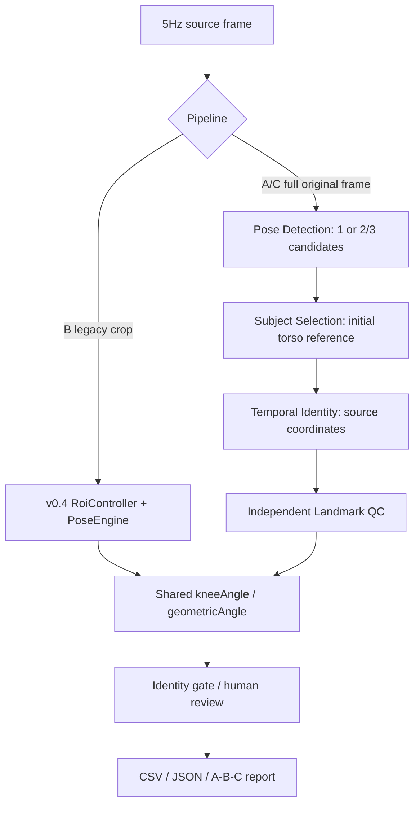
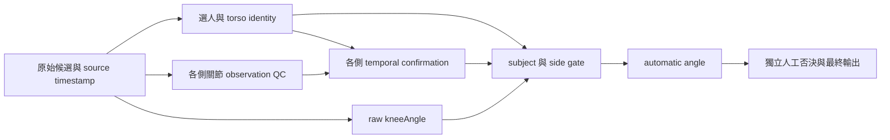

# Architecture

狀態：v0.6 主流程為 Full Frame + Single Pose；ROI／Multi-Pose／A/B/C 比較收至實驗區。現行規約見 [SINGLE_SUBJECT_DEMO.md](SINGLE_SUBJECT_DEMO.md)，真實單人 Squat 待驗收。

## 模組與依賴規則

| 位置 | 責任／邊界 |
| --- | --- |
| src/app | React 上傳、分析進度、播放與匯出流程 |
| src/domain/measurement.ts | 型別契約，版本、側別、時間與有效性；不是執行時 validator |
| src/input | 來源解碼、影格索引、來源尺寸／時間；不得計算角度 |
| src/pose | MediaPipe adapter，處理 runtime lifecycle 與原始 landmark／confidence |
| src/biomechanics | 純函式 QC、座標轉換、版本化角度，不依賴 UI／MediaPipe API |
| src/motion | 時間序列、峰值與有效區間 ROM；不隱藏無效缺口 |
| src/visualization | 畫面座標映射／letterbox、骨架、角度與 Recharts 曲線 |
| src/export | CSV 逐列量測、JSON session metadata 與二維 landmarks |
| validation | Python 離線參考標註與誤差分析，尚無執行程式 |

兩種輸入都轉為同一 Frame → Pose → Biomechanics 管線，不得複製角度演算法。
未來可使用 worker 降低 UI 阻塞，須量測後再決定；本次不預設多執行緒。

## 座標、時間與有效性

來源 xy normalized → source pixel xy → 2D geometry；顯示縮放／裁切／鏡像只在顯示層。
保留 normalized 原始值的受限本機研究輸出與 QC 證據，不把它們放入 public Git。
MediaPipe world landmarks 為模型估計空間，必須與 pixel 2D 分開命名、儲存及驗證。
Video timestamp 用媒體時間；camera 用單調 source clock、起點歸零。不得用推論完成時間
代替拍攝時間；重複／逆序時間、seek、掉幀須明確處理，seek 開新 segment。

AngleValue 為 discriminated union：valid=true 有 raw angle；valid=false 時 angle=null
並附非空 reason。數字是否有限、範圍與 metadata 完整性仍需未來 runtime validation。
低 confidence 不等於經校準機率；不同 landmark 欄位不可混為同一信心。

## 資料與服務

目前無後端、資料庫或遠端上傳；靜態 Vite app 在瀏覽器內分析 MP4。
未來 camera 需要 HTTPS 或受信任的本機 origin 及使用者授權；onboarding 不提供預覽連結。
模型已記錄套件版本、模型來源／asset ID、SHA-256、CPU delegate；設定見 docs/MODEL_SETUP.md。
CSV 每側每取樣一列，無效角度空欄附 validity/reasons；JSON 攜帶 metadata 與 normalized xy、visibility、可用的 presence 與 crop-relative z（沒有 world landmarks）。
目前 schemaVersion=9；不把 sample_index 冒充來源 frame index。CSV 所有欄位加引號，文字公式前綴轉義。

## V0 offline sampling and playback contract

1. 驗證 MP4，讀取長度與尺寸；上限 500 MB、10 分鐘。容器副檔名檢查之外，還必須通過瀏覽器解碼。
2. 以獨立的暫停 video decoder，依 k/5 秒（k≥0，時間小於 duration）固定目標網格逐次 seek。
3. 優先使用 rVFC 的 mediaTime 或已知影格快取；同時間 seek 不依賴重新送出事件。若尋時已完成且 readyState≥2，150 ms 仍無回呼則讀取可繪製影格，時間明記 seek-position-estimate，不是精確 PTS。保存 requested_time_ms、source_time_ms 及 decode provenance。
   將當時 video 畫面畫到來源尺寸 canvas 再推論，不在播放迴圈做推論。
4. 來源時間重複／逆序時跳過，不把相同影格重複送入 VIDEO；sample_index 是保留取樣的連續索引。
5. 每次分析建立全新的 PoseLandmarker，完成／失敗／取消後 close 並釋放 decoder。
   切片、seek 或播放不會修改既有結果；換影片或模型清除結果。取消不提供部分 session 匯出。
6. UI 播放用 presented media timestamp 對應取樣，容許 1 ms timestamp rounding；不插值。
   暫停且 video 離開 viewport 可能節流 rVFC，完成同一個已分析 seek 目標後，
   依該目標映射回保存的 decoded frame time。任意未分析影格顯示 N/A、隱藏骨架。
7. 左右有效率的分母為保留的不重複取樣數，分子為該側通過 QC 的取樣數；
   不是全部影片影格的 tracking validity，也不是臨床效度。

固定的是目標時間網格，不是跨瀏覽器完全一致的影格解碼或模型數值。
VFR／低 FPS 可能少於預計取樣；不做全影格解碼或穩健視角分類。
骨架與 video 同一顯示矩形、無裁切／鏡像，normalized xy 對應來源比例。
幾何計算前乘來源寬高；visibility 或可用 presence <0.5、出框、非有限值、
confidence 不在 [0,1]、缺點或任一向量 <1e-6 px 判為無效。0° 本身是有效幾何結果，不能與退化向量混淆。
未做濾波、峰值、ROM 或 3D 分析。推論在主執行緒，可能影響 UI 流暢度，尚未訂效能門檻。

## Subject ROI / tracking / human review（0.3.0）

Input seek 原圖 → canvas 裁切 ROI → PoseEngine 的獨立候選陣列 → fromCrop 原圖映射 →
TargetTracker 四維篩檢 → rawAngles／automaticAngles → 人工 review → 最終角度、圖表、CSV。
ROI 固定且 referenceTimeMs=0；所有來源時間與 5 Hz 目標網格不變。

新增 src/tracking（純 TS：ROI、可替換 TargetTracker、identity gate），
src/validation（純指標、人工覆核及 React review panel）。核心 knee.ts 仍只處理幾何與點位 QC，
不能靠 knee visibility 推論人物身份。具體門檻、鎖定策略與指標分母見 SUBJECT_TRACKING.md。

Sample.candidates 保留每組 crop 與原圖 landmarks（若有 z，仍為 crop-relative 模型深度，沒有還原為原圖 z）；
不跨候選拼骨架、不以 candidate index 當 identity。trackingPolicy 與 subjectSelection 進 session JSON，
CSV 附 ROI／自動與最終 validity／人工標籤／政策版本。原始模型結果不因人工覆核被覆寫。

0.3.0 的 crop-relative z 只供受限研究查核，不做 3D 計算。

## ROI 編輯與 keyframes（Phase A）

草稿與分析 session 分離；Apply 建立新 selection ID／revision，舊分析標記 stale 並保留原始 JSON。完成重分析後保留前版記憶體存檔。
Manual Keyframes 使用影片尋時位置（media-position ms）記錄人工重新確認，固定 5 Hz 目標網格不變；線性插值 source-pixel x/y/width/height，最後一框之後保持。每 sample 記錄實際 ROI、更新原因、manual keyframe ID。
到達新人工 keyframe 的第一個取樣重新建立模型／tracker，避免沿用錯誤內部追蹤；角度永遠來自該次實際模型觀測，不插值。selection 與分析版本記錄 parentSelectionId／parentSessionId，重分析不修改舊 session。

## v0.4.0 current controller contract

前述 0.3.0 固定／永久鎖定策略為歷史基線，現行實作以 docs/ROI_TRACKING.md 為準。
Input read → RoiController.propose → crop PoseEngine → 可選 independent full-frame PoseEngine →
source mapping → RoiController.observe／state machine → pure knee angles → identity gate → human review → final export。
Controller 只用前一 accepted pose 更新下一框；明確記錄每 sample ROI／state／source／reason及 decode time basis。
短期失效可在 650 ms 內兩次嚴格確認後恢復；歧義與長期失效不可自動接人。
搜尋最多2 candidates 只作建議與歧義證據，不把搜尋點自動覆蓋 primary measurements。
新 manual keyframe／mode／selection 造成新 revision 與 stale；重分析產生新 session，保留 parent 及原 JSON。

## v0.5.0 pipeline separation

現行比較規約以 PIPELINE_COMPARISON.md 為準。既有 ROI_TRACKING.md 描述 B 的保留基線。

A/C 的 inference ROI 永遠為全圖；targetReferenceRoi 不是裁切範圍，選人與裁切分離。
完整raw候選保留，subjectDecision 記 selected／proposed index（不當固定身分）。
同源 runner 固定影片／模型hash、selection與5Hz，獨立依序執行三法並保留單法失敗。
不直接宣稱每法 decoder 取得相同呈現影格；輸出 common target grid、timing basis、已知偏移及完整分母。

## v0.5.1 QC 分離（v0.6沿用，初始化更新見下節）

本節取代上文以全身幾何 gate 身分的描述，詳見 [QC_REPLAY.md](QC_REPLAY.md)。
Detection／ROI／5Hz 工作流不擴充；A/C 完整影格、B 原裁切設計維持。
`identity.ts` 只用 torso／候選證據做 identity state 與歷史更新；`target.ts` 為 B 包裝 crop 的 torso 約束。
`biomechanics/jointQuality.ts` 為每側純觀測 QC；`tracking/jointQuality.ts` 為每側 temporal state／確認序列。

schema8 `tracking.accepted` 描述身分規則，`tracking.joints.left/right` 記錄 observationValid／observationReasons、
temporal、READY／INVALID／RECOVERING／SUSPENDED、source pixel段長、baselineBeforePx／recoveryAnchorPx、確認數與理由。
各側 gate 不因另一側失敗而輸出零值或全段鎖定。B 只有身分與兩側 QC 都可靠才使用該姿態更新跟隨。
Raw candidates、原始 angles、automatic、human review 分離。CSV 附 subject_tracking_accepted／joint_qc_* 與 replay strategy。
Offline replay 使用相同核心；CLI 不載入 MediaPipe 或模型、不啟動 HTTP listener，寫入獨立 ignored outputs。

## v0.6 單人主要流程

UI 與 analyze 共用 DEFAULT_PIPELINE（完整原尺寸影格／numPoses1）。上傳成功由 input/singleSubject.ts 建立全圖參考，
source=controlled-single-default；不要求ROI、不偽造人工確認／manualKeyframeId。核心幾何／逐側QC與5Hz時間序列共用，保留實驗分支。
主要UI只需影片／模型、分析、影格／角度／曲線與CSV／研究JSON；管線選擇、ROI與比較預設收合，研究診斷及標註另收合。
初始未取得可靠torso時可等待，不因首筆空觀測直接人工鎖定；可靠初始化後仍受原identity安全恢復與逐側joint確認。
全圖樣本previousState保存實際上一筆狀態，不固定寫TRACKING；schema9與policy版本反映本版語意。
實驗設定切回主要模式會stale、不修改舊結果，收合編輯只取消草稿。沒有相機或新增追蹤演算法。
