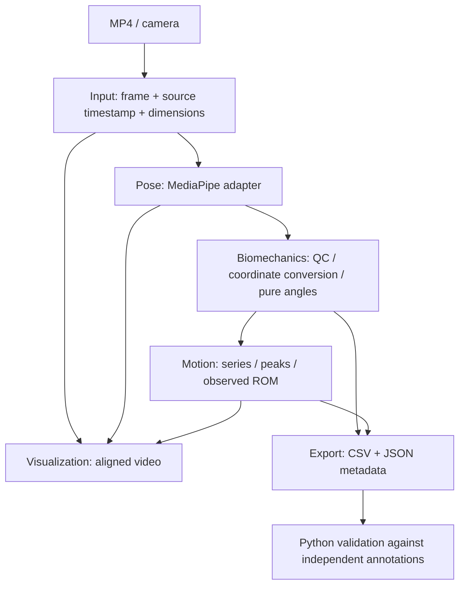

# Architecture

狀態：模組責任與 TypeScript 契約已建立；除狀態頁外，各分析模組尚未實作。

## 模組與依賴規則

| 位置 | 責任／邊界 |
| --- | --- |
| src/app | React UI 與流程編排；目前只有狀態頁 |
| src/domain/measurement.ts | 型別契約，版本、側別、時間與有效性；不是執行時 validator |
| src/input | 來源解碼、影格索引、來源尺寸／時間；不得計算角度 |
| src/pose | MediaPipe adapter，處理 runtime lifecycle 與原始 landmark／confidence |
| src/biomechanics | 純函式 QC、座標轉換、版本化角度，不依賴 UI／MediaPipe API |
| src/motion | 時間序列、峰值與有效區間 ROM；不隱藏無效缺口 |
| src/visualization | 畫面座標映射／letterbox、骨架、角度與 Recharts（待加入） |
| src/export | CSV 逐列量測、JSON session metadata／schema（待實作） |
| validation | Python 離線參考標註與誤差分析，尚無執行程式 |

兩種輸入都轉為同一 Frame → Pose → Biomechanics 管線，不得複製角度演算法。
未來可使用 worker 降低 UI 阻塞，須量測後再決定；本次不預設多執行緒。

## 座標、時間與有效性

來源 xy normalized → source pixel xy → 2D geometry；顯示縮放／裁切／鏡像只在顯示層。
保留 normalized 原始值的受限本機研究輸出與 QC 證據，不把它們放入 public Git。
MediaPipe world landmarks 為模型估計空間，必須與 pixel 2D 分開命名、儲存及驗證。
Video timestamp 用媒體時間；camera 用單調 source clock、起點歸零。不得用推論完成時間
代替拍攝時間；重複／逆序時間、seek、掉幀須明確處理，seek 開新 segment。

AngleValue 為 discriminated union：valid=true 有 raw angle；valid=false 時 angle=null
並附非空 reason。數字是否有限、範圍與 metadata 完整性仍需未來 runtime validation。
低 confidence 不等於經校準機率；不同 landmark 欄位不可混為同一信心。

## 資料與服務

目前無後端、資料庫或遠端上傳；靜態 Vite app 只顯示初始化資訊。
未來 camera 需要 HTTPS 或受信任的本機 origin 及使用者授權；onboarding 不提供預覽連結。
未來模型需記錄套件版本、模型 URL／asset ID、SHA-256、delegate 與設定。
CSV 計畫每側每影格一列，無效值空欄附 validity/reasons；JSON 攜帶完整 metadata。
契約改動必須提升 schemaVersion；本次沒有匯出器或已凍結的 CSV schema。
