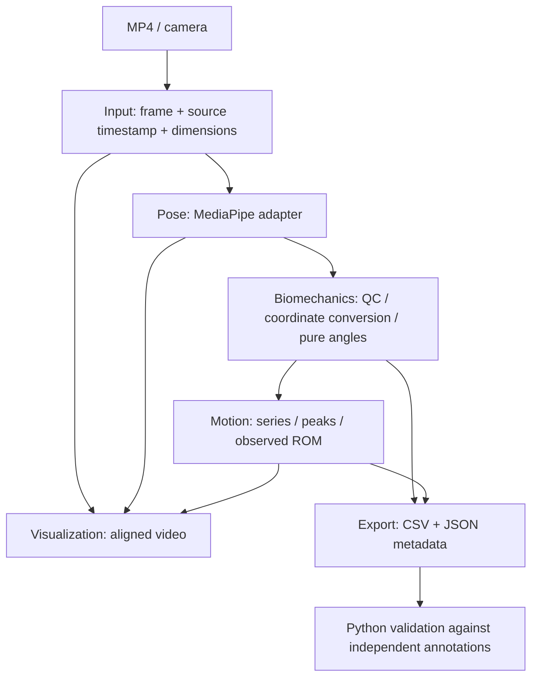

# Architecture

狀態：V0 候選實作已串接；自動軟體測試通過，真實人體模型推論尚待驗收。

## 模組與依賴規則

| 位置 | 責任／邊界 |
| --- | --- |
| src/app | React 上傳、分析進度、播放與匯出流程 |
| src/domain/measurement.ts | 型別契約，版本、側別、時間與有效性；不是執行時 validator |
| src/input | 來源解碼、影格索引、來源尺寸／時間；不得計算角度 |
| src/pose | MediaPipe adapter，處理 runtime lifecycle 與原始 landmark／confidence |
| src/biomechanics | 純函式 QC、座標轉換、版本化角度，不依賴 UI／MediaPipe API |
| src/motion | 時間序列、峰值與有效區間 ROM；不隱藏無效缺口 |
| src/visualization | 畫面座標映射／letterbox、骨架、角度與 Recharts 曲線 |
| src/export | CSV 逐列量測、JSON session metadata 與二維 landmarks |
| validation | Python 離線參考標註與誤差分析，尚無執行程式 |

兩種輸入都轉為同一 Frame → Pose → Biomechanics 管線，不得複製角度演算法。
未來可使用 worker 降低 UI 阻塞，須量測後再決定；本次不預設多執行緒。

## 座標、時間與有效性

來源 xy normalized → source pixel xy → 2D geometry；顯示縮放／裁切／鏡像只在顯示層。
保留 normalized 原始值的受限本機研究輸出與 QC 證據，不把它們放入 public Git。
MediaPipe world landmarks 為模型估計空間，必須與 pixel 2D 分開命名、儲存及驗證。
Video timestamp 用媒體時間；camera 用單調 source clock、起點歸零。不得用推論完成時間
代替拍攝時間；重複／逆序時間、seek、掉幀須明確處理，seek 開新 segment。

AngleValue 為 discriminated union：valid=true 有 raw angle；valid=false 時 angle=null
並附非空 reason。數字是否有限、範圍與 metadata 完整性仍需未來 runtime validation。
低 confidence 不等於經校準機率；不同 landmark 欄位不可混為同一信心。

## 資料與服務

目前無後端、資料庫或遠端上傳；靜態 Vite app 在瀏覽器內分析 MP4。
未來 camera 需要 HTTPS 或受信任的本機 origin 及使用者授權；onboarding 不提供預覽連結。
模型已記錄套件版本、模型來源／asset ID、SHA-256、CPU delegate；設定見 docs/MODEL_SETUP.md。
CSV 每側每取樣一列，無效角度空欄附 validity/reasons；JSON 攜帶 metadata 與 normalized xy、visibility、可用的 presence（沒有 z／world landmarks）。
目前 schemaVersion=2；不把 sample_index 冒充來源 frame index。CSV 所有欄位加引號，文字公式前綴轉義。

## V0 offline sampling and playback contract

1. 驗證 MP4，讀取長度與尺寸；上限 500 MB、10 分鐘。容器副檔名檢查之外，還必須通過瀏覽器解碼。
2. 以獨立的暫停 video decoder，依 k/5 秒（k≥0，時間小於 duration）固定目標網格逐次 seek。
3. 等待 seeked 與 requestVideoFrameCallback；保存 requested_time_ms 與實際 mediaTime（source_time_ms）。
   將當時 video 畫面畫到來源尺寸 canvas 再推論，不在播放迴圈做推論。
4. 來源時間重複／逆序時跳過，不把相同影格重複送入 VIDEO；sample_index 是保留取樣的連續索引。
5. 每次分析建立全新的 PoseLandmarker，完成／失敗／取消後 close 並釋放 decoder。
   切片、seek 或播放不會修改既有結果；換影片或模型清除結果。取消不提供部分 session 匯出。
6. UI 播放用 presented media timestamp 對應取樣，容許 1 ms timestamp rounding；不插值。
   暫停且 video 離開 viewport 可能節流 rVFC，完成同一個已分析 seek 目標後，
   依該目標映射回保存的 decoded frame time。任意未分析影格顯示 N/A、隱藏骨架。
7. 左右有效率的分母為保留的不重複取樣數，分子為該側通過 QC 的取樣數；
   不是全部影片影格的 tracking validity，也不是臨床效度。

固定的是目標時間網格，不是跨瀏覽器完全一致的影格解碼或模型數值。
VFR／低 FPS 可能少於預計取樣；不做全影格解碼或穩健視角分類。
骨架與 video 同一顯示矩形、無裁切／鏡像，normalized xy 對應來源比例。
幾何計算前乘來源寬高；visibility 或可用 presence <0.5、出框、非有限值、
confidence 不在 [0,1]、缺點或任一向量 <1e-6 px 判為無效。0° 本身是有效幾何結果，不能與退化向量混淆。
未做濾波、峰值、ROM 或 3D 分析。推論在主執行緒，可能影響 UI 流暢度，尚未訂效能門檻。
