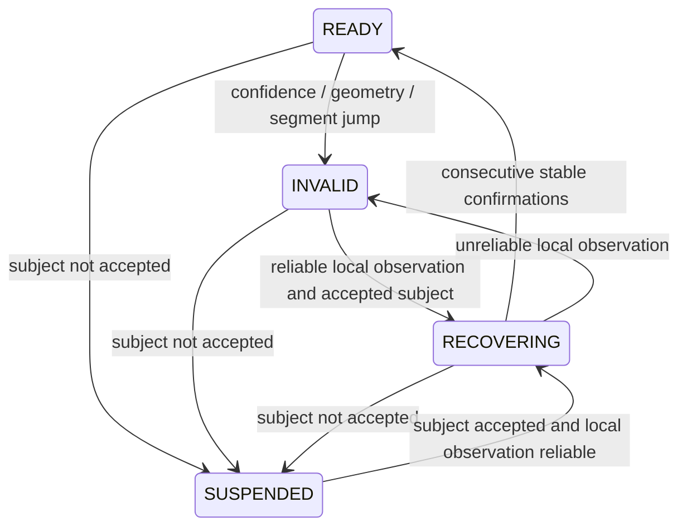

# v0.5.1 — 追蹤 QC 診斷與離線重播

> v0.6：主要流程已收斂為單人完整影格，見 [SINGLE_SUBJECT_DEMO.md](SINGLE_SUBJECT_DEMO.md)。本文件保留研究／實驗規約；replay現可讀schema7/8/9，新派生結果為schema9。

2026-11-17 · schema 8 · `separate-identity-joint-recovery-v5`。

## 證據與診斷

團隊回報同一真實 Mendeley Squat A/B/C 各自動有效 4/155，0.8 秒觸發腿段尺度異常後進入
MANUAL_REVIEW_REQUIRED，其餘 151 筆持續拒絕；raw 左膝 A/B 155、C 149 可計算。
目前環境未收到原始研究 JSON、影片或有效模型，不能核對實際骨段比例、候選人物或修正後真實數字。

原始程式的確有以下可重現路徑：

- v0.5.0 `identity.ts`：任何可比較腿段比最後 accepted 長度變化 >2，直接設人工鎖定。
  `state==='MANUAL_REVIEW_REQUIRED'` 每次都會強制 accepted=false；新好觀測無法更新 baseline。
- v0.5.0 `target.ts`：腿段與軀幹共用 temporal-jump-or-scale-change；implausibility 也是 hard failure。
  hard → 人工鎖定，原 reject／recovery 亦把腿段穩定程度當成身分恢復條件。
- 原 `poseQuality` 把軀幹、腿段、全身 bounds 合併成單一 accepted，A/C 直接拿來 gate identity。
- `analyze.ts` 再用全域 tracking.accepted gate 左右膝。除非人工 keyframe 建新 tracker，鎖定會沿用至片尾。

這確認程式機制，沒有單憑錯誤碼證明真實影片中一定是 false rejection、選對人物或數學角度準確。

## 分離後的責任

| 層級 | 觀測／規則 | 能否改變身分歷史 |
| --- | --- | --- |
| Subject identity | 唯一位置／時間一致候選、可信雙肩雙髖、torso bounds／位移／尺度、短期恢復 | 只有通過的 torso 更新；不使用膝踝尺度證明身分 |
| Joint observation | 各側 hip-knee-ankle 的 finite、confidence、bounds、退化／骨段比例 | 不可；各側 `observationValid`／`observationReasons` 獨立保留 |
| Joint temporal consistency | 相較該側 accepted segments 的跳變、恢復 streak | 不可；另存 `temporal`、`state`、長度／baseline／anchor／confirmations |
| Measurement | 原始 kneeAngle 再經 subject 與該側 joint gate | 不更新 tracker；null 與理由，沒有補值 |

`biomechanics/jointQuality.ts` 是純觀測幾何；`tracking/jointQuality.ts` 管每側時間狀態。
`identity.ts` 只用 torso 更新身分歷史，`target.ts` 為 B 加入 crop 的 torso 邊界與初始位置約束。
既有 `poseQuality` 留作整體觀測描述，不再把局部腿部失敗直接用來鎖定 identity。
A/B/C 共用此分離契約，保留選人、座標轉換、detector 設定、5Hz 與角度定義。
B 跟隨函式／門檻未擴充；局部關節不可信時也暫停利用這組點更新 crop，防止錯腿驅動下一框。

## 身分與各側狀態機

身分維持 TRACKING / UNCERTAIN / LOST / MANUAL_REVIEW_REQUIRED：

- torso 失信／短暫缺失 → UNCERTAIN／LOST，不輸出有效角度。
- 650ms 內兩次 torso 確認，中心差≤0.5 torso、尺度比≤1.25 才能恢復。
- 多候選歧義、可靠 torso 的速度>3 torso/s 或尺度比>2、非遞增時間、恢復不一致、
  長時間無 reliable identity、B 搜尋歧義／失敗仍鎖定人工確認。
- 人工鎖定不會由好膝角或累積確認次數自動解除；只有明確 manual keyframe／新 tracker。

各側關節狀態：



保留 confidence≥0.5、torso≥8px、leg segment≥2px、同側投影長度比≤5、temporal segment scale≤2 等原工程門檻。
恢復只使用觀測，不用補值：至少兩次（實驗對照三次）連續、身分通過、每側 observation 通過，
source gap≤300ms、段長相對上一筆**及該恢復窗口首筆**尺度比≤1.25。
缺點／失信重設 streak；跳過時間或不穩定段長重啟確認，不把等待樣本 retroactively 標成有效。
恢復可以建立新的投影長度 baseline，只有確認完成的當前樣本開始放行；靜態異常不會靠等待自行變有效。
局部失敗不耗盡身分的 650ms budget，只要 torso 持續可靠；真正 torso 缺失仍受該 budget 限制。
身分短期恢復與關節確認可先後發生，因此部分片段的有效率可能比舊版更低，不以 coverage 最大化調參。

這些是未經人體校準的工程規則。高信心、穩定且幾何合理的混合骨架仍可能通過。
允許穩定局部重建 baseline 亦可能錯放；三次確認不是已證實更準，需配合新增放行清單人工判讀。

## CLI 與資料契約

```sh
npm ci
npm run qc:replay -- --input "/path/to/comparison.json" --output outputs/qc-replay-01
# 或在依賴已安裝後直接執行
node scripts/qc-replay.mjs --input "/path/to/research.json" --output outputs/qc-replay-02
```

CLI 使用已安裝 Vite 的本機 TS loader，共用 live 分析的純 QC 實作，沒有 HTTP listener／HMR、
模型載入、MediaPipe 推論、影片解碼或外部請求。接受單一原始 schema7/8 session、比較 bundle 或 `{bundle, report}`。
拒絕缺 raw candidates/source-mapped landmarks、無效時間、無輸入區域 metadata、舊 schema 或已重播 session。
缺失候選陣列與明確空陣列（當時無偵測）不同；不從已選中 landmarks 猜測未保存候選。
缺少的 landmarks 或 raw 點座標為 null／非有限值時保留原觀測並拒絕量測，不變成零；無法辨識的資料結構則拒絕整份輸入。

三個策略：

- frozen-v0.5.0：凍結的原 identity／target／observation／initial selection 實作，重建舊策略。
- separated-2：新版分離與兩次 local confirmation，為 live 預設。
- separated-3：同一身分規則、三次 local confirmation，僅用 replay 對照；沒有新增 UI 選項。

`original` 指標直接來自輸入，不以重算版本代替；`baselineDecisionDifferences` 列重算與原紀錄的差異。
若凍結策略仍與原結果不同，先調查 schema／程式／版本／manual resets 等，不能直接作新舊因果結論。
Manual keyframe ID 改變時依當時紀錄重設 tracker，沿用原始 source timestamps 與每筆實際 ROI。
B 只重播當時的 primary candidates，並保留已記錄搜尋歧義／錯誤要求人工；不重新產生搜尋或跟隨。
因此它是 **conditional on saved observations**：新 QC 若會改變下一 crop，僅靠舊候選無法重建新 detection。
不能把 replay 結果稱為完整新版影片重分析。

輸出目錄必須是 `outputs/` 下不存在的新子目錄；拒絕覆寫、絕不修改輸入。
每策略獨立 session ID／parent／qcReplay／policy；raw candidates、時戳、model hash 等保留。
原 detection 的 run（包含 pipeline、影片 hash、原推論耗時）在 `qcReplay.detectionRun`，
派生 session 不冒充新的 MediaPipe run。`report.inputFileSha256` 是輸入 JSON bytes 的 hash，與影片 hash 不同。
輸出含原始人體特徵，受既有 .gitignore 與資料管理規則保護，不可入 Public Git。

## 報告欄位與分母

全部以 sample 為單位，左右兩側不當作兩個影格；`samples=N` 為各計數分母。

| 報告欄位 | 定義／限制 |
| --- | --- |
| rawPoseAvailable | 至少一候選有 raw landmarks 的筆數，不要求身分／量測有效 |
| rawGeometricAngles | 該代表候選經原 kneeAngle 計算可用的側別數；仍非角度真值 |
| subjectTrackingAccepted | 身分一致性規則通過數，不等於左右膝有效或真人正確率 |
| jointMeasurementValid | 原 automatic gate 的左／右／any／both 數，新策略同時要求該側 QC |
| finalAfterHumanReview | 人工否決後的最終側別有效數，不抹去 automatic 原決策 |
| manualReviewRequired | 全域人工鎖定筆數，局部關節失效不直接算在此處 |
| failureEpisodes | 分身分／左／右的拒絕區間，記 recovered-without-manual-reset、ended-at-manual-reset、unresolved-at-end；後者僅表示觀察至檔尾未恢復 |
| identityReasons / jointReasons | 身分碼與各側 QC 碼分開統計；jointReasons 包含恢復完成的追溯碼，不全部叫作 failure |
| artificiallyAcceptedSamplesAfterQcChanges | 原自動無效→新自動有效至少一側，列 sample/time/side/人工判斷；這是新增放行的稽核清單，不是已證實錯誤數 |

新增放行分 `humanWrongOrMixed`、`humanUncertain`、`correctTargetOnly`、`notAdjudicated`。
`manualRejected` 為 Wrong/Mixed/Uncertain 導致最終否決的合計，Uncertain 不是已證實錯人。
人工 Correct 只能支持人物判讀，不能支持角度 accuracy。
若重播選了不同 evaluated landmarks，不沿用原候選的 review；原標籤仍在原檔與 changes 裡，改列 not-adjudicated。
0.6–1.4秒窗口保存時戳、觀測段長、raw angles、原／新 QC、候選決策與新 baseline／恢復 anchor，支援逐筆檢查。

## 本次實際驗證及待驗收

合成程式案例，**不是 Mendeley 實測**：155 筆固定 5Hz，僅第0.8秒兩膝投影段長跳變，torso 保持不變。

| 策略 | Raw pose | Subject accepted | 左／右 auto valid | Manual required | 新增放行／未人工判讀 |
| --- | --- | --- | --- | --- | --- |
| 原／凍結 v0.5.0 | 155 | 4 | 4／4 | 151 | 0 |
| 分離＋兩次確認 | 155 | 155 | 153／153 | 0 | 149／149 |
| 分離＋三次確認 | 155 | 155 | 152／152 | 0 | 148／148 |

新兩次策略0.8秒 invalid、1.0秒 recovering、1.2秒才 valid；三次為1.4秒才 valid。
三法 A/B/C 的這個合成案例相同，不推廣到真人場景；真實輸出的 raw availability 也未必相同。

本次需以原始研究 JSON 執行重播、確認 frozen parity、人工判讀新增放行與所有歧義區間，
並對新增可用角度另作關節 landmark／角度參考驗證。若允許，再用原片跑新版 A/B/C 比較實際 crop feedback。
沒有該資料前，不提供真人修正後 Valid Frame Rate、Accuracy 或最佳恢復規則結論。
