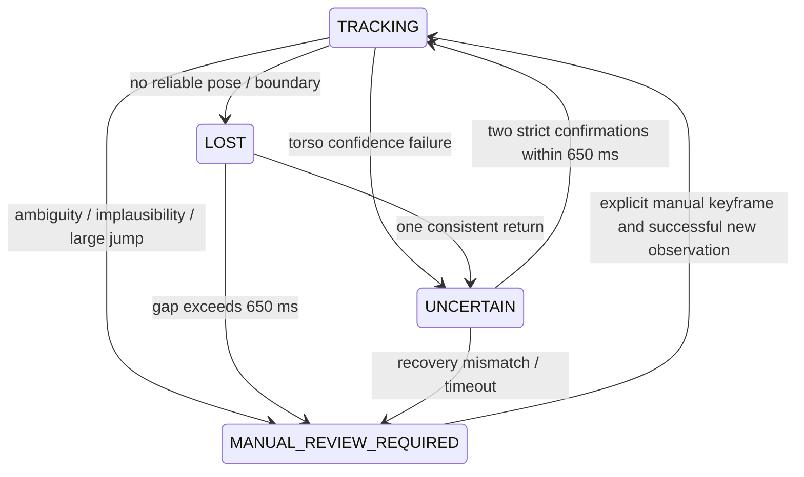

# ROI controller, decoder and recovery — v0.4.0 retained baseline

> v0.6：主要流程已收斂為單人完整影格，見 [SINGLE_SUBJECT_DEMO.md](SINGLE_SUBJECT_DEMO.md)。本文件保留研究／實驗規約；replay現可讀schema7/8/9，新派生結果為schema9。

> v0.5.1：下列為先前策略／比較規約；目前 QC 與恢復以 [QC_REPLAY.md](QC_REPLAY.md) 為準。裁切／取樣／候選契約保留，腿段不再單獨永久鎖定身分。

v0.5.0 暫停擴充此管線，保留作 B 對照；新的 A/B/C 比較見 [PIPELINE_COMPARISON.md](PIPELINE_COMPARISON.md)。

2026-11-17 · schema 6 · QC pixel-xy-visible-present-0.5-and-roi-controller-v3。

## Decoder

seekFrame 優先回傳 rVFC mediaTime；已知相同位置影格可快取重用，無須等待 no-op seek 的新事件。
若 !seeking、currentTime 已到目標且 readyState≥2，150 ms 仍未有 callback，讀取可繪製影格，
明記 timeBasis=seek-position-estimate。它是來源媒體尋時位置，不是精確 PTS。
15 秒 deadline 不延長；未完成尋時／無可用畫面／真正 MediaError 以不同 code 及狀態診斷。
同一位置的 UI seek 使用可取消 promise 並 finally 清除 waiting，不因未送 seeked 卡住編輯器。
僅精確 presentation 時間能在播放中直接對應骨架；估計時間只在暫停且已知相同 seek 目標下對應。
同一影片的呈現 PTS 若可辨識為重複／逆序則跳過；估計模式無法保證去除所有重複影格，不能宣稱全影格分析。

## Editable ROI and keyframes

sourcePoint 將縮放顯示座標映回來源像素；move／8 handles／numeric fit 保持邊界與最小 32 px。
草稿、已套用 selection、舊 session 分開。Apply 建立新 ID／revision／correctionSource，標舊分析 stale，
不直接修改舊 landmarks、ROI 或人工標註。新分析保留 parentSessionId，舊 JSON 可獨立下載。
存檔只在記憶體，沒有資料庫／server upload／session import。

Keyframes timeMs 為影片 media-position ms；包含 0 秒、時間唯一、不可在 duration 邊界之外。
manual-keyframes：相鄰 x/y/w/h 在來源像素線性插值，round + 邊界限制，最後一框 hold。
adaptive-roi：人工 keyframe 是 reset seed，不在其前後預先插值未來框；兩次人工校正之間由 accepted pose 跟隨。
fixed：全片使用同一 ROI。模式改變只在 Apply 時生效，亦記 mode-change。
跨人工 keyframe 的第一個保留取樣重建 primary PoseEngine 與 TargetTracker，避免沿用錯誤內部狀態。
仍重分析整片，保留 5 Hz 目標網格；不把不同版本或插值角度拼接。

## Controller interface

createRoiController 包含 propose(timestamp) 與 observe(candidates,timestamp,plan,searchCandidates?,searchFailure?)。
它保存 previous ROI、previous accepted source landmarks、tracking state、manual keyframes。
FramePlan 提供實際 ROI、source／reason、manualKeyframeId、previousState、resetModel、searchDue；
observe 提供四維 QC、state、搜尋候選與建議。所有 sample 保存實際方案及原始觀測。
Biomechanics 核心不依賴 UI 或 tracker，僅以來源像素幾何計算 rawAngles；身份 gate 再產生 automaticAngles。

## Adaptive policy — bounded-torso-follow-v1

僅前一筆 accepted pose 能驅動下一框。以雙肩／雙髖中心與 torso 尺度、人工 seed 框相對偏移估計位置。
可信可見點提供 15% margin，避免 limb 裁切；但高 confidence 的錯點仍可能造成錯框。
平滑係數 0.35，單次中心移動限制為上一框各軸尺寸的 8%，寬／高變化最多 5%（整數 rounding 容許 1 px）。
torso 尺度相對 seed 限 [0.5,2]；框保持來源邊界內。不使用拒絕姿態更新框，失效時 hold。
所有工程門檻寫入 trackingPolicy，未做臨床／真實資料效度校準。

## Full-frame assistance

Adaptive 使用獨立 VIDEO engine（最多 2 poses），與 primary（1 pose）分開，避免同 timestamp 重複送入同實例。
正常約每 1000 ms 搜尋；初次失效即搜尋，短期 LOST／UNCERTAIN 可每 200 ms 重查；
MANUAL_REVIEW_REQUIRED 仍受約每秒預算限制，不持續每個取樣多跑搜尋。
搜尋與 primary 使用相同暫停原始影格，原始 source timestamps 不變；記錄 full ROI／候選／狀態。
比較可靠 torso 與前一 accepted（初始則 primary）位置，近似門檻 0.75 torso、尺度比≤1.5；多個近候選要求人工。
遠處無關人物不因存在就等同歧義。最多兩候選不代表已偵測全場景，更不代表身分真值。
唯一近候選只產生 suggestedRoi，**不替換 primary landmarks 或直接放行角度**。ROI 外完全失去的人可能仍需人工 keyframe。
搜尋初始化／推論失敗時記 error、要求人工、不反覆初始化同一已失敗 engine；可改用 Manual Keyframes。
此環境未以有效 Lite 檔驗證 2-pose 實際效能；失敗路徑已測，不宣稱已確認真實多人 model accuracy 或 FPS。

## Recovery state machine — roi-temporal-recovery-v2

保留原有 confidence／geometry／temporal thresholds。短期恢復另須與最後 accepted 中心差≤0.5 torso，
torso 與可比較腿段尺度比≤1.25，並連續兩次確認；等待恢復的樣本仍 invalid。首次尚無 baseline 不自動接人。
只有 TRACKING＋幾何 QC 才能產生自動有效角度；它仍是 consistent-unverified，不是身份證明。
相似的人平滑交錯仍可能通過；不能把可用率上升或規則通過當 ground truth。

## Traceability and exports

session：模型 package／asset hash、selection keyframes／revision／parent、analysis parent、所有 policy versions。
sample：raw crop/source landmarks（可含 input-relative z）、decode provenance、實際 ROI／更新原因、
previousState／resetModel、四維 QC／state／reasons、rawAngles、automaticAngles、人工 review、最終角度、搜尋原始候選。
CSV 使用逐 sample ROI，不再重複初始框；附 timing basis、state、搜尋狀態、版本與人工標註。
人工判錯仍只改最終角度，不抹去 auto validity，保留 Target Accuracy／False-Valid 的正確分母。

## Acceptance boundary

合成單元／瀏覽器已驗證編輯、keyframes、漂移、輕微 camera pan、短期遺失恢復、多人歧義拒絕、
搜尋失敗、安全校正與舊 session 不變。指定 subject_002_squat_good_side.mp4 及有效模型不在此環境，真實驗收待團隊執行。
以同檔 hash、同模型 hash／5 Hz 目標網格、同指定受測者，比較自動 valid、人工 identity labels、
FVR、usable coverage、狀態分布、timing basis 與效能；禁止將模擬資料曲線寫成真實 Squat 結果。
